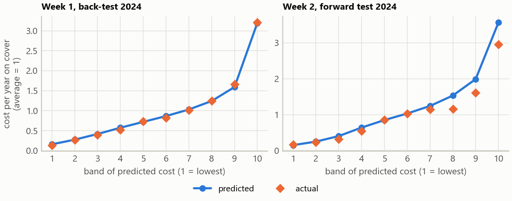
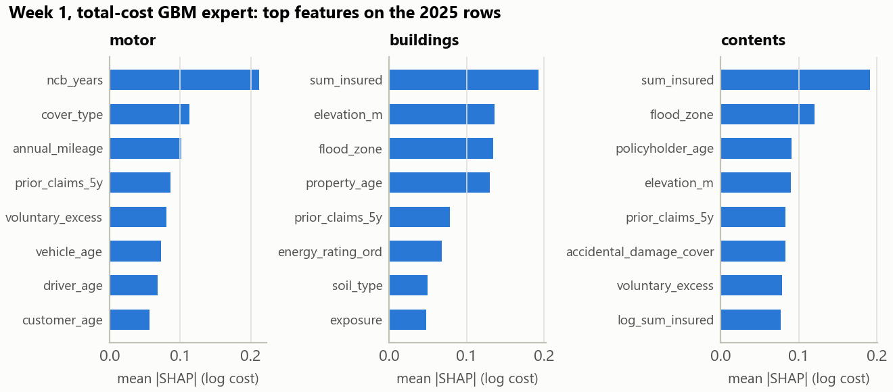

# Model diagnostics

Written by `final/diagnostics.py`, which explains each check. Every number comes from the pipeline's own data and code.

## Reproduction checks

| check                                                                               | value   |
|:------------------------------------------------------------------------------------|:--------|
| prior refit against the stored prior (largest log difference)                       | 0.0e+00 |
| SHAP additivity, step 5: SHAP sum + offset against the log prediction               | 1.8e-15 |
| GLM refit against the stored motor GLM predictions (largest relative difference)    | 2.2e-15 |
| GLM refit against the stored contents GLM predictions (largest relative difference) | 2.2e-15 |

## Calibration and lift

| check                       | rows   | d2    | a_over_e   | lift_top_over_bottom   | band_a_over_e_min   | band_a_over_e_max   |
|:----------------------------|:-------|:------|:-----------|:-----------------------|:--------------------|:--------------------|
| Week 1, back-test 2023      | 626355 | 0.138 | 0.995      | 23.404                 | 0.930               | 1.107               |
| Week 1, back-test 2024      | 626190 | 0.137 | 0.994      | 23.371                 | 0.871               | 1.044               |
| Week 2, forward test 2024   | 59202  | 0.130 | 0.858      | 18.002                 | 0.755               | 1.091               |
| Week 2, out of fold 2023-24 | 109296 | 0.142 | 0.968      | 26.036                 | 0.745               | 1.054               |

`lift_bands.csv` has every band. A/E below 1 means the model predicted more than came in.

## A/E by segment, Week 2

| check                       | segment                       | claims   | exposure_share   | a_over_e   |
|:----------------------------|:------------------------------|:---------|:-----------------|:-----------|
| Week 2, forward test 2024   | buildings, new business       | 37       | 0.023            | 0.469      |
| Week 2, forward test 2024   | buildings, renewals           | 500      | 0.233            | 0.609      |
| Week 2, forward test 2024   | contents, new business, men   | 33       | 0.015            | 1.195      |
| Week 2, forward test 2024   | contents, new business, women | 32       | 0.014            | 1.510      |
| Week 2, forward test 2024   | contents, renewals, men       | 210      | 0.143            | 0.768      |
| Week 2, forward test 2024   | contents, renewals, women     | 232      | 0.145            | 1.029      |
| Week 2, forward test 2024   | motor, new business, men      | 215      | 0.019            | 0.873      |
| Week 2, forward test 2024   | motor, new business, women    | 167      | 0.019            | 1.027      |
| Week 2, forward test 2024   | motor, renewals, men          | 1759     | 0.192            | 1.220      |
| Week 2, forward test 2024   | motor, renewals, women        | 1350     | 0.196            | 0.941      |
| Week 2, out of fold 2023-24 | buildings, new business       | 77       | 0.020            | 0.751      |
| Week 2, out of fold 2023-24 | buildings, renewals           | 979      | 0.237            | 0.918      |
| Week 2, out of fold 2023-24 | contents, new business, men   | 56       | 0.012            | 1.230      |
| Week 2, out of fold 2023-24 | contents, new business, women | 46       | 0.012            | 1.212      |
| Week 2, out of fold 2023-24 | contents, renewals, men       | 424      | 0.146            | 0.837      |
| Week 2, out of fold 2023-24 | contents, renewals, women     | 472      | 0.147            | 1.132      |
| Week 2, out of fold 2023-24 | motor, new business, men      | 379      | 0.016            | 1.338      |
| Week 2, out of fold 2023-24 | motor, new business, women    | 318      | 0.017            | 1.126      |
| Week 2, out of fold 2023-24 | motor, renewals, men          | 3564     | 0.194            | 1.042      |
| Week 2, out of fold 2023-24 | motor, renewals, women        | 2787     | 0.198            | 0.910      |

## SHAP, Week 2

## SHAP, Week 1

The refitted trees against the expert's cached 2025 predictions:

| line      | trees   | max_rel_diff   | log_corr   |
|:----------|:--------|:---------------|:-----------|
| motor     | 316     | 6.66e-16       | 1.00e+00   |
| buildings | 226     | 6.66e-16       | 1.00e+00   |
| contents  | 237     | 6.66e-16       | 1.00e+00   |

The three strongest features of each model and line (all of them in `shap_importance.csv`):

| model                          | line      | feature                     | mean_abs_shap   | direction                                        |
|:-------------------------------|:----------|:----------------------------|:----------------|:-------------------------------------------------|
| developed prior (step 4)       | motor     | ncb_years                   | 0.296           | higher value, lower cost (rank corr -0.97)       |
| developed prior (step 4)       | motor     | age_band_mid                | 0.173           | higher value, lower cost (rank corr -0.81)       |
| developed prior (step 4)       | motor     | cover_type                  | 0.116           | highest: comprehensive, lowest: third_party_only |
| developed prior (step 4)       | buildings | sum_insured                 | 0.222           | higher value, higher cost (rank corr +0.98)      |
| developed prior (step 4)       | buildings | flood_zone                  | 0.140           | higher value, higher cost (rank corr +0.29)      |
| developed prior (step 4)       | buildings | elevation_m                 | 0.137           | higher value, lower cost (rank corr -0.94)       |
| developed prior (step 4)       | contents  | sum_insured                 | 0.269           | higher value, higher cost (rank corr +0.99)      |
| developed prior (step 4)       | contents  | flood_zone                  | 0.134           | higher value, higher cost (rank corr +0.69)      |
| developed prior (step 4)       | contents  | elevation_m                 | 0.095           | higher value, lower cost (rank corr -0.83)       |
| LightGBM on the prior (step 5) | motor     | gender                      | 0.088           | highest: m, lowest: f                            |
| LightGBM on the prior (step 5) | motor     | cover_type                  | 0.037           | highest: comprehensive, lowest: third_party_only |
| LightGBM on the prior (step 5) | motor     | ncb_years                   | 0.033           | higher value, higher cost (rank corr +0.64)      |
| LightGBM on the prior (step 5) | buildings | property_age                | 0.054           | higher value, higher cost (rank corr +0.90)      |
| LightGBM on the prior (step 5) | buildings | elevation_m                 | 0.038           | higher value, lower cost (rank corr -0.18)       |
| LightGBM on the prior (step 5) | buildings | wx_wind_exposure_index_mean | 0.027           | higher value, higher cost (rank corr +0.36)      |
| LightGBM on the prior (step 5) | contents  | winter_fraction             | 0.068           | higher value, lower cost (rank corr -0.28)       |
| LightGBM on the prior (step 5) | contents  | tenure                      | 0.017           | highest: renter, lowest: owner                   |
| LightGBM on the prior (step 5) | contents  | sum_insured                 | 0.013           | higher value, lower cost (rank corr -0.09)       |
| total-cost GBM expert (Week 1) | motor     | ncb_years                   | 0.212           | higher value, lower cost (rank corr -0.92)       |
| total-cost GBM expert (Week 1) | motor     | cover_type                  | 0.113           | highest: comprehensive, lowest: third_party_only |
| total-cost GBM expert (Week 1) | motor     | annual_mileage              | 0.102           | higher value, higher cost (rank corr +0.95)      |
| total-cost GBM expert (Week 1) | buildings | sum_insured                 | 0.193           | higher value, higher cost (rank corr +0.99)      |
| total-cost GBM expert (Week 1) | buildings | elevation_m                 | 0.137           | higher value, lower cost (rank corr -0.93)       |
| total-cost GBM expert (Week 1) | buildings | flood_zone                  | 0.134           | higher value, higher cost (rank corr +0.44)      |
| total-cost GBM expert (Week 1) | contents  | sum_insured                 | 0.191           | higher value, higher cost (rank corr +0.99)      |
| total-cost GBM expert (Week 1) | contents  | flood_zone                  | 0.120           | higher value, higher cost (rank corr +0.65)      |
| total-cost GBM expert (Week 1) | contents  | policyholder_age            | 0.090           | higher value, lower cost (rank corr -0.38)       |

## GLM relativities, Week 2

The GLM expert is in the ensemble for contents, motor. `glm_relativities.csv` lists every factor level with its relativity to the factor's largest level and the years on cover behind it.
