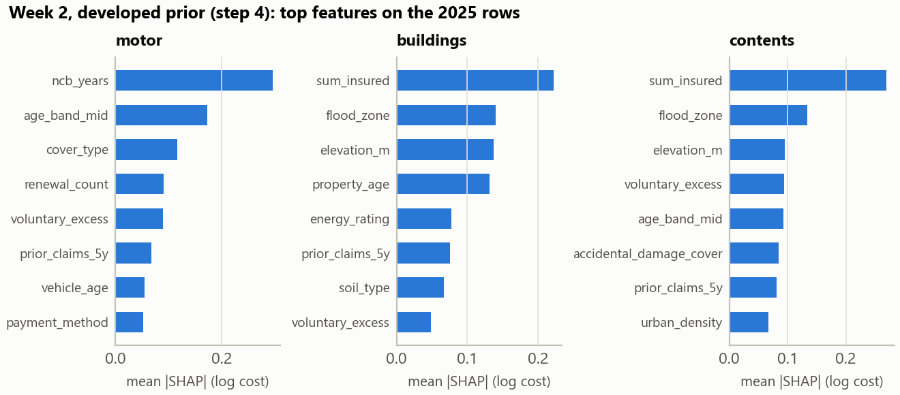
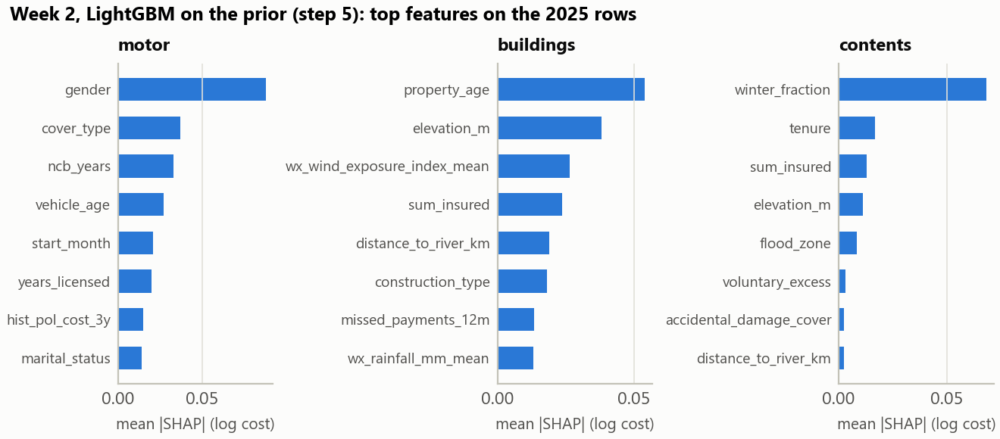

# Model diagnostics

Written by `final/diagnostics.py`, which explains each check. Every number comes from the pipeline's own data and code.

## Reproduction checks

| check                                                                               | value   |
|:------------------------------------------------------------------------------------|:--------|
| prior refit against the stored prior (largest log difference)                       | 0.0e+00 |
| SHAP additivity, step 5: SHAP sum + offset against the log prediction               | 1.8e-15 |
| GLM refit against the stored motor GLM predictions (largest relative difference)    | 2.1e-15 |
| GLM refit against the stored contents GLM predictions (largest relative difference) | 2.2e-15 |

## SHAP, Week 2

The three strongest features of each model and line (all of them in `shap_importance.csv`):

| model                          | line      | feature                     | mean_abs_shap   | direction                                        |
|:-------------------------------|:----------|:----------------------------|:----------------|:-------------------------------------------------|
| developed prior (step 4)       | motor     | ncb_years                   | 0.296           | higher value, lower cost (rank corr -0.97)       |
| developed prior (step 4)       | motor     | age_band_mid                | 0.173           | higher value, lower cost (rank corr -0.81)       |
| developed prior (step 4)       | motor     | cover_type                  | 0.116           | highest: comprehensive, lowest: third_party_only |
| developed prior (step 4)       | buildings | sum_insured                 | 0.222           | higher value, higher cost (rank corr +0.98)      |
| developed prior (step 4)       | buildings | flood_zone                  | 0.140           | higher value, higher cost (rank corr +0.29)      |
| developed prior (step 4)       | buildings | elevation_m                 | 0.137           | higher value, lower cost (rank corr -0.94)       |
| developed prior (step 4)       | contents  | sum_insured                 | 0.269           | higher value, higher cost (rank corr +0.99)      |
| developed prior (step 4)       | contents  | flood_zone                  | 0.134           | higher value, higher cost (rank corr +0.69)      |
| developed prior (step 4)       | contents  | elevation_m                 | 0.095           | higher value, lower cost (rank corr -0.83)       |
| LightGBM on the prior (step 5) | motor     | gender                      | 0.088           | highest: m, lowest: f                            |
| LightGBM on the prior (step 5) | motor     | cover_type                  | 0.037           | highest: comprehensive, lowest: third_party_only |
| LightGBM on the prior (step 5) | motor     | ncb_years                   | 0.033           | higher value, higher cost (rank corr +0.64)      |
| LightGBM on the prior (step 5) | buildings | property_age                | 0.054           | higher value, higher cost (rank corr +0.90)      |
| LightGBM on the prior (step 5) | buildings | elevation_m                 | 0.038           | higher value, lower cost (rank corr -0.18)       |
| LightGBM on the prior (step 5) | buildings | wx_wind_exposure_index_mean | 0.027           | higher value, higher cost (rank corr +0.36)      |
| LightGBM on the prior (step 5) | contents  | winter_fraction             | 0.068           | higher value, lower cost (rank corr -0.28)       |
| LightGBM on the prior (step 5) | contents  | tenure                      | 0.017           | highest: renter, lowest: owner                   |
| LightGBM on the prior (step 5) | contents  | sum_insured                 | 0.013           | higher value, lower cost (rank corr -0.09)       |

## GLM relativities, Week 2

The GLM expert is in the ensemble for contents, motor. `glm_relativities.csv` lists every factor level with its relativity to the factor's largest level and the years on cover behind it.
